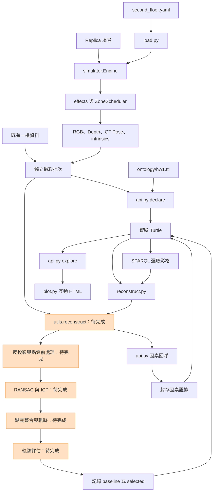
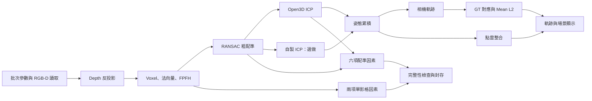

目前專案可分成三部分：**資料擷取、RGB-D 重建核心、實驗與語意資料管理**。資料擷取及實驗管理已有具體實作；作業主要待完成部分集中在 `utils.py`，目前尚不能完成端到端重建。

以下依本機原始碼分析，未修改任何檔案、未安裝套件，也未執行擷取、重建、實驗或測試。文中的「已實作」表示原始碼已有實際邏輯，不代表本次已驗證執行成功。

**1. 專案整體架構**

| 檔案／資料夾 | 用途與目前狀態 |
|---|---|
| [README.md](/Users/alyssa/Documents/Codex_Workspace/physicalai_hw1/README.md:1) | 專案入口說明，介紹環境、資料擷取、宣告實驗與重建工作流程。 |
| [pixi.toml](/Users/alyssa/Documents/Codex_Workspace/physicalai_hw1/pixi.toml:1)、[pixi.lock](/Users/alyssa/Documents/Codex_Workspace/physicalai_hw1/pixi.lock:1) | 宣告環境相依套件、任務與鎖定版本；`habitat-lab`、`simulator` 使用本機 editable 套件。 |
| [load.py](/Users/alyssa/Documents/Codex_Workspace/physicalai_hw1/load.py:154) | 資料擷取入口。載入 YAML、初始化模擬器及預覽介面，執行鍵盤擷取或 GT Pose 軌跡重播。**已實作**。 |
| [configs/second_floor.yaml](/Users/alyssa/Documents/Codex_Workspace/physicalai_hw1/configs/second_floor.yaml:1) | 場景、相機、移動、光照、Depth 雜訊、空間干擾區域及輸出設定。 |
| [packages/simulator/simulator](/Users/alyssa/Documents/Codex_Workspace/physicalai_hw1/packages/simulator/simulator/__init__.py:1) | 擷取功能的主要套件，將模擬器、影像效果、重播與顯示分開。 |
| [reconstruct.py](/Users/alyssa/Documents/Codex_Workspace/physicalai_hw1/reconstruct.py:66) | 重建 CLI 與流程協調器：讀實驗、選影格、呼叫重建、評估及寫入結果。**流程已有實作，但依賴未完成核心**。 |
| [utils.py](/Users/alyssa/Documents/Codex_Workspace/physicalai_hw1/utils.py:18) | RGB-D 反投影、點雲前處理、ICP、重建與軌跡評估。**主要作業實作區**。 |
| [api.py](/Users/alyssa/Documents/Codex_Workspace/physicalai_hw1/api.py:2332) | 本機實驗管理 CLI 與 RDF 資料處理函式；不是 HTTP 伺服器。提供 `declare`、`batch2ttl`、`query`、`explore`。 |
| [ontology/hw1.ttl](/Users/alyssa/Documents/Codex_Workspace/physicalai_hw1/ontology/hw1.ttl:291) | 定義實驗、資料批次、影格、因素、設定與重建結果的語意結構。 |
| [plot.py](/Users/alyssa/Documents/Codex_Workspace/physicalai_hw1/plot.py:197) | 讀取已記錄因素與結果，透過 Panel／Bokeh 產生互動圖表。**已實作**。 |
| `eval/_data/` | 擷取資料；各批次包含 `rgb/`、`depth/`、`intrinsics.json`、`GT_pose.npy`。 |
| `replica_v1/apartment_0/` | Habitat-Sim 使用的 Replica 場景資產。 |
| `dependencies/habitat-lab/` | 本機 Habitat-Lab 相依程式，不是本次 TODO 的主要範圍。 |
| [docs/](/Users/alyssa/Documents/Codex_Workspace/physicalai_hw1/docs/e2e-workflow.md:1) | 各模組與工作流程文件；部分描述與目前程式不一致，需以原始碼為準。 |
| [packages/simulator/tests/](/Users/alyssa/Documents/Codex_Workspace/physicalai_hw1/packages/simulator/tests/test_import_surface.py:1) | 模擬器匯入介面、影像效果、空間區域與重播測試。本次未執行。 |
| `experiments/` | **預期產生的輸出目錄，目前根目錄尚未存在**；每個實驗包含 Turtle、查詢與圖表子目錄。 |

`simulator` 套件內部的責任分工如下：

| 模組 | 主要責任 |
|---|---|
| [config.py:78](/Users/alyssa/Documents/Codex_Workspace/physicalai_hw1/packages/simulator/simulator/config.py:78) | 讀取 YAML，將缺少的光照、Depth、干擾設定補上預設值。 |
| [engine.py:173](/Users/alyssa/Documents/Codex_Workspace/physicalai_hw1/packages/simulator/simulator/engine.py:173) | 管理 Habitat-Sim、代理人、感測器、觀測快取及每影格亂數。 |
| [effects.py:212](/Users/alyssa/Documents/Codex_Workspace/physicalai_hw1/packages/simulator/simulator/effects.py:212) | 處理 RGB 光照、Depth 故障與光照耦合，產生可儲存及預覽的影格。 |
| [effects.py:343](/Users/alyssa/Documents/Codex_Workspace/physicalai_hw1/packages/simulator/simulator/effects.py:343) | `ZoneScheduler`：依代理人的世界座標 XZ 決定目前所在干擾區域。 |
| [replay.py:28](/Users/alyssa/Documents/Codex_Workspace/physicalai_hw1/packages/simulator/simulator/replay.py:28) | 讀取 Pose 軌跡、建立擷取目錄、儲存影格與內部參數、重播相機姿態。 |
| [viewer.py:107](/Users/alyssa/Documents/Codex_Workspace/physicalai_hw1/packages/simulator/simulator/viewer.py:107) | pygame 預覽畫面與局部更新。 |

整體呼叫與資料流如下。橘色節點表示已有介面或骨架，但核心仍待完成；後續箭頭表示設計上的流程，目前會受 TODO 阻擋。

**2. TODO 實作盤點**

以下盤點專案自身程式，排除第三方 `dependencies/habitat-lab/` 與已安裝套件。實質演算法 TODO 集中於 **6 個函式、7 處 `NotImplementedError`**；另有實驗宣告範本中的文字 TODO。

「必要」是依目前標準重建流程的相依需求判定；正式配分仍需以課程規格為準。自製 ICP 則由程式明確標示為 Bonus Track。

| 分類 | 函式／位置 | TODO 行號 | 預期功能 |
|---|---|---|---|
| 必要 | [`depth_image_to_point_cloud`](/Users/alyssa/Documents/Codex_Workspace/physicalai_hw1/utils.py:18) | 35、37、40、41、43、45、53；55 阻擋 | 轉換並驗證輸入陣列、確認深度單位、建立像素網格、過濾無效深度、推導相機參數、執行針孔反投影、建立含 RGB 色彩的點雲。 |
| 必要 | [`preprocess_point_cloud`](/Users/alyssa/Documents/Codex_Workspace/physicalai_hw1/utils.py:58) | 67、68、71、73；75 阻擋 | Voxel 降取樣、估算法向量、計算 FPFH，回傳降取樣點雲與特徵。 |
| 必要 | [`local_icp_algorithm`](/Users/alyssa/Documents/Codex_Workspace/physicalai_hw1/utils.py:78) | 86、88、90、92；95 阻擋 | 補足法向量、呼叫 Open3D Point-to-Plane ICP、設定收斂條件、保留完整配準結果。 |
| 選做加分 | [`my_local_icp_algorithm`](/Users/alyssa/Documents/Codex_Workspace/physicalai_hw1/utils.py:98) | 109、110、111、112、114、118、119；121 阻擋 | 自行建立 ICP 疊代、尋找對應點、剔除過遠對應、求解及累積剛體更新、判斷收斂、回傳轉換矩陣。**求解方法存在衝突，見後文。** |
| 必要 | [`reconstruct` Stage 1](/Users/alyssa/Documents/Codex_Workspace/physicalai_hw1/utils.py:167) | 167；171 阻擋 | 讀取該批次的 `intrinsics.json`，建立 RGB／Depth 配對及選取順序。 |
| 必要 | [`reconstruct` Stage 2](/Users/alyssa/Documents/Codex_Workspace/physicalai_hw1/utils.py:183) | 183 | 讀取 RGB-D、處理無法讀取的影格、將深度轉為公尺。 |
| 必要 | [`reconstruct` Stage 3、4](/Users/alyssa/Documents/Codex_Workspace/physicalai_hw1/utils.py:191) | 191、194 | 呼叫反投影與前處理。**呼叫敘述已保留，函式本體未完成。** |
| 必要 | [`reconstruct` Stage 6](/Users/alyssa/Documents/Codex_Workspace/physicalai_hw1/utils.py:205) | 205 | 使用 FPFH 與 RANSAC，產生粗配準結果及 `trans_init`。 |
| 必要 | [`reconstruct` Stage 7](/Users/alyssa/Documents/Codex_Workspace/physicalai_hw1/utils.py:208) | 208 | 依後端選擇 Open3D 或自製 ICP。**分支與呼叫已保留。** |
| 必要 | [`reconstruct` Stage 8](/Users/alyssa/Documents/Codex_Workspace/physicalai_hw1/utils.py:217) | 217 | 將目前影格到前一影格的轉換，累積至首影格座標系。 |
| 必要 | [`reconstruct` Stage 10](/Users/alyssa/Documents/Codex_Workspace/physicalai_hw1/utils.py:250) | 250 | 記錄成功處理影格的相機位置。**252 行已有 append，仍依賴前面的姿態累積。** |
| 必要 | [`reconstruct` Stage 11](/Users/alyssa/Documents/Codex_Workspace/physicalai_hw1/utils.py:255) | 255 | 依累積轉換整合點雲，選擇性降低輸出地圖點數；目前只有 `pass`。 |
| 必要 | [`reconstruct` Stage 12](/Users/alyssa/Documents/Codex_Workspace/physicalai_hw1/utils.py:261) | 261 | 更新上一影格狀態與進度。**263–269 行已有敘述。** |
| 必要 | [`visualize_and_evaluate` 評估](/Users/alyssa/Documents/Codex_Workspace/physicalai_hw1/utils.py:303) | 303、305、308、310；316 阻擋 | 讀取及對應 GT、處理缺失資料、協調座標系、計算相機中心 Mean L2。 |
| 標準視覺化流程 | [`visualize_and_evaluate` 顯示](/Users/alyssa/Documents/Codex_Workspace/physicalai_hw1/utils.py:326) | 326、327、328；331 阻擋 | 建立紅色預測軌跡、黑色 GT 軌跡與 Open3D 顯示幾何；`show=False` 應可跳過此部分。 |

`api.py` 的 TODO 性質不同：

- [`cmd_declare` 891、893、913 行](/Users/alyssa/Documents/Codex_Workspace/physicalai_hw1/api.py:890)：產生 `pipeline` 預測、`baseline` 預測及實驗標籤的待填文字。它們是**每個實驗的敘述欄位**，不是尚未實作的 API。
- 958 行只是提醒使用者填寫；1255 與 2374 行則是說明文字，不是新增演算法工作。
- 儘管 `read_declaration` 的說明提到 prediction TODO，實際函式內沒有拒絕未填預測文字的檢查；產生器本身也會讓初始範本通過驗證。[api.py:942](/Users/alyssa/Documents/Codex_Workspace/physicalai_hw1/api.py:942)、[api.py:1254](/Users/alyssa/Documents/Codex_Workspace/physicalai_hw1/api.py:1254)

TODO 相依關係可整理為：

**3. 場景重建流程與完成狀態**

| 階段 | 程式結構與資料契約 | 現況 |
|---|---|---|
| RGB-D 讀取 | 依批次讀取 `intrinsics.json` 與同名影格，Depth PNG 的 `uint16` 毫米須轉成公尺。 | **待完成**；目前 `pairs`、`rgb`、`depth_m`、`stem` 等仍需建立。 |
| Depth Unprojection | 使用批次的寬、高、水平視角推導焦距與主點；由 `(u,v,z)` 建立三維點，丟棄深度 ≤ 0 的像素；BGR 轉 RGB 並正規化色彩。 | **待完成**。 |
| Voxel Downsampling | 以 `voxel_size` 降取樣；法向量搜尋半徑為其 2 倍、最多 30 鄰點；FPFH 半徑為其 5 倍、最多 100 鄰點。 | **待完成**。 |
| RANSAC | 將目前點雲配準至前一個已處理點雲，取得粗轉換與配準統計。文件描述 FPFH 配對及幾何檢查。 | **待完成**；目前沒有實際 RANSAC 呼叫。 |
| ICP | 使用粗轉換初始化，Open3D 標準後端預期為 Point-to-Plane；距離門檻在骨架中為 `1.5 × voxel_size`。 | **待完成**；後端分支已存在。 |
| 姿態累積 | `T_global` 表示目前相機座標到首影格相機座標的轉換；每影格記錄其平移作為相機中心。 | **初始化與 append 已有，轉換累積待完成**。 |
| 3D 場景整合 | 把點雲轉換至共同座標系並合併；`build_cloud=False` 的介面契約要求不影響軌跡估計。 | **待完成**；目前沒有 TSDF 融合或其他完整表面重建實作。 |
| 去除天花板 | 合併後依相機座標 Y 軸裁掉最低 Y 附近的 1 公尺區帶。 | [`remove_ceiling_points` 已實作](/Users/alyssa/Documents/Codex_Workspace/physicalai_hw1/utils.py:124)，目前因上游阻擋而不可達。 |
| 軌跡評估 | 讀 GT、對應選取影格、固定座標轉換後計算相機中心 Mean L2。 | **待完成**。 |
| 結果圖片 | 建立地圖與軌跡，優先使用 Open3D，失敗時嘗試 Matplotlib 圖片輸出。 | [`save_reconstruction_image` 已實作](/Users/alyssa/Documents/Codex_Workspace/physicalai_hw1/utils.py:338)，本次未執行。 |

上述重建骨架位於 [utils.py:142](/Users/alyssa/Documents/Codex_Workspace/physicalai_hw1/utils.py:142)。第一個 `raise` 在 171 行，因此其後已有的因素回呼、分支、進度輸出與回傳邏輯，**目前皆不會被實際執行**。

軌跡評估的契約尤其重要：[utils.py:281](/Users/alyssa/Documents/Codex_Workspace/physicalai_hw1/utils.py:281)

- 預測軌跡使用首影格相機座標，影像軸為右、下、前。
- GT 為世界座標的 `[x,y,z,qw,qx,qy,qz]`。
- 預期先翻轉預測的 Y、Z，再用首筆 GT 姿態將 GT 轉到首相機座標系。
- 不應另外對 GT 做最佳旋轉、尺度或平移擬合。
- 指標是相機中心的平均歐氏距離，**不是點雲表面誤差**。
- 選取影格應依檔名在批次中的排序位置對應 GT 列，不能直接假定 `GT[stem-1]` 永遠正確。

**4. 資料驗證、Ontology、Turtle 與 SPARQL**

這部分的目的，是將「使用哪批影像、採用什麼設定、量測到哪些中間結果、重建結果如何」記錄成可查詢的本機 RDF 圖。

| 概念 | 實際用途 |
|---|---|
| Ontology | 定義詞彙與結構，例如 `Batch`、`Frame`、`QualityFactor`、`Factor`、`FactorSetting`、`ReconstructionRun`。 |
| Turtle `.ttl` | RDF 的文字儲存格式。Ontology 本身與每個實驗都使用 Turtle。 |
| `QualityFactor` | 可重複使用的因素定義，例如 `RawPointCount`。 |
| `Factor` occurrence | 某個實驗、某張 Depth 或某一對 Depth 的具體量測，包含值與狀態。 |
| SPARQL | 使用 RDFLib 在本機查詢已記錄資料；選取查詢可回傳下一次重建要消耗的影格。 |
| `api.py` | 負責解析、驗證、序列化、封存與查詢，不負責完成 ICP 等幾何演算法。 |

因素結構定義見 [ontology/hw1.ttl:428](/Users/alyssa/Documents/Codex_Workspace/physicalai_hw1/ontology/hw1.ttl:428)；本機查詢入口見 [api.py:412](/Users/alyssa/Documents/Codex_Workspace/physicalai_hw1/api.py:412)。這套流程不需要遠端資料庫或原始 GitHub Repository。

實驗生命週期如下；這是程式行為說明，本次未執行：

1. **宣告實驗。** `cmd_declare` 接收名稱、資料目錄與樓層，建立 `experiments/<name>/<name>.ttl`、`plots/`、`queries/`。此時不量測因素，也不重建。名稱、檔名與實驗 IRI 必須一致，既有檔案不覆寫。[api.py:847](/Users/alyssa/Documents/Codex_Workspace/physicalai_hw1/api.py:847)
2. **第一次完整批次重建。** 未封存實驗必須先走完整批次，不接受選取查詢或 `--no-write`。資料來源直接取自宣告中的 `batchFile`。[reconstruct.py:124](/Users/alyssa/Documents/Codex_Workspace/physicalai_hw1/reconstruct.py:124)
3. **取得因素。** `utils.reconstruct` 在處理影格與配準時發出回呼，`api.make_pipeline_measurement_callback` 收集結果。[api.py:1000](/Users/alyssa/Documents/Codex_Workspace/physicalai_hw1/api.py:1000)
4. **檢查完整性。** 每張影格都必須有兩項因素，每對相鄰消耗影格必須有六項因素；缺少紀錄即中止封存。[reconstruct.py:161](/Users/alyssa/Documents/Codex_Workspace/physicalai_hw1/reconstruct.py:161)
5. **評估、封存並記錄 baseline。** 先計算 Mean L2、輸出圖片，再附加 MACHINE SECTION、宣告摘要值及因素，最後寫 baseline run。[reconstruct.py:183](/Users/alyssa/Documents/Codex_Workspace/physicalai_hw1/reconstruct.py:183)
6. **查詢與選取重建。** SPARQL 選取必須回傳 `?frame` 或 `?frameIndex`；結果去重、依整數排序，且必須屬於該批次。[api.py:422](/Users/alyssa/Documents/Codex_Workspace/physicalai_hw1/api.py:422)
7. **呈現與比較。** `explore` 顯示設定、因素、run 結果；對已量測實驗呼叫 `plot.py`，也支援多個實驗比較。[api.py:2258](/Users/alyssa/Documents/Codex_Workspace/physicalai_hw1/api.py:2258)

八項因素的實際來源如下：

| 因素 | 粒度 | 來源／意義 |
|---|---|---|
| `RawPointCount` | 每張 Depth | 反投影後有效點數。 |
| `VoxelizedPointYield` | 每張 Depth | Voxel 降取樣後點數；**是點數，不是保留比例**。 |
| `CoarseRANSACFitness` | 每對 Depth | RANSAC 結果的 `fitness`。 |
| `CoarseRANSACRMSE` | 每對 Depth | RANSAC 結果的 `inlier_rmse`。 |
| `CoarseRANSACCorrespondences` | 每對 Depth | RANSAC 對應點集合大小。 |
| `ICPInlierFitness` | 每對 Depth | ICP 結果的 `fitness`。 |
| `ICPInlierRMSE` | 每對 Depth | ICP 結果的 `inlier_rmse`。 |
| `ICPInlierCorrespondences` | 每對 Depth | ICP 對應點集合大小。 |

來源為 [utils.py:197](/Users/alyssa/Documents/Codex_Workspace/physicalai_hw1/utils.py:197)、[utils.py:222](/Users/alyssa/Documents/Codex_Workspace/physicalai_hw1/utils.py:222)、[api.py:1015](/Users/alyssa/Documents/Codex_Workspace/physicalai_hw1/api.py:1015)。

對包含 \(N\) 張影格的完整批次，預期共有：

\[
2N+6(N-1)=8N-6
\]

筆因素紀錄。因此，先前驗證的 191 張一樓資料，完整處理時應有 **1,522 筆**；兩張 `env_test` 則應有 **10 筆**。這是依程式結構推算，尚未產生量測。

`mapMeanL2` 是 `ReconstructionRun` 的直接結果，**不屬於八項因素**。[ontology/hw1.ttl:273](/Users/alyssa/Documents/Codex_Workspace/physicalai_hw1/ontology/hw1.ttl:273)

封存的範圍也有限：摘要值保護的是宣告文字；它**不是影像、GT、設定檔及程式碼的完整雜湊封存**。[api.py:1560](/Users/alyssa/Documents/Codex_Workspace/physicalai_hw1/api.py:1560)

圖表與比較已有以下邏輯：

- 八項因素時間序列，滑鼠移入時顯示 RGB／Depth 縮圖。
- 因素分布直方圖。
- 保留影格比例與已記錄 Mean L2 的比較圖。
- 輸出 `dashboard.html`、`timelines.html`、`distributions.html`、`tradeoff.html`。
- 每個實驗以 `baseline`、`selected` 為 run 識別，因此目前最多兩個模式的結果點；再次寫同模式會更新該紀錄，不是增加完整歷史。
- 不會自行掃描參數、重跑重建、制定通過門檻或推論因果。

對應 [plot.py:333](/Users/alyssa/Documents/Codex_Workspace/physicalai_hw1/plot.py:333)、[plot.py:347](/Users/alyssa/Documents/Codex_Workspace/physicalai_hw1/plot.py:347)、[plot.py:384](/Users/alyssa/Documents/Codex_Workspace/physicalai_hw1/plot.py:384)、[api.py:700](/Users/alyssa/Documents/Codex_Workspace/physicalai_hw1/api.py:700)。

**5. 目前可調整的參數與資料介入介面**

以下只整理既有介面，不選擇數值或提出實驗策略。

| 層級 | 現有可調整項目 | 記錄／實作狀態 |
|---|---|---|
| 重建 CLI | `--voxel-size`，預設 0.05 公尺；`--seed`，預設 0；`--version` | 已有引數解析；核心尚待實作。 |
| Ontology 實驗設定 | `icpBackend`：`open3d`、`my_icp` | **目前唯一正式宣告的 `hw1:Parameter`**；CLI 後端不得與實驗紀錄衝突。 |
| 核心函式介面 | `frames`、`build_cloud`、`down_voxel`、`registration_seed`、兩種 callback | 介面已存在；部分尚無有效實作。 |
| 相機／移動 | 尺寸、HFOV、相機位置與方向、起始位置、移動與轉向步長 | 由 YAML 供擷取器使用。 |
| RGB 光照 | brightness、contrast、gamma、ambient_rgb、flicker amplitude／frequency／phase | 效果函式已有實作。 |
| Depth 故障 | 啟用／停用、stuck、noise_std、dropout_prob、quantization、距離範圍 | 已有實作。 |
| 光照與 Depth 耦合 | light_nominal、light_noise_gain、light_dropout_gain、light_range_gain | 光照偏離基準時影響雜訊、掉點與最大距離，已有實作。 |
| 空間干擾 | 區域中心、半徑、順序、閃爍幅度與頻率；`uncertainties.seed` | 區域以 XZ 位置判定，重疊時先匹配者優先；seed 控制 Depth 亂數。 |
| 擷取方式 | 互動操作、`.npy` Pose 重播、`--fps`、`--output-root`、`--clean` | 已有實作。 |
| 影格介入 | SPARQL 選取影格子集 | 不修改原始影像，只改變重建消耗哪些影格。 |
| 批次來源關係 | `batch2ttl --derived-from` | 可記錄來源批次關係，**不負責產生修改後資料**。 |

重建參數見 [reconstruct.py:83](/Users/alyssa/Documents/Codex_Workspace/physicalai_hw1/reconstruct.py:83)；Ontology 設定見 [ontology/hw1.ttl:412](/Users/alyssa/Documents/Codex_Workspace/physicalai_hw1/ontology/hw1.ttl:412)；干擾參數見 [config.py:19](/Users/alyssa/Documents/Codex_Workspace/physicalai_hw1/packages/simulator/simulator/config.py:19)。

有兩項需特別區分：

- `voxel_size`、RANSAC seed 雖能從 CLI 傳入，**目前沒有像 `icpBackend` 一樣自動成為 Turtle 的正式設定紀錄**。
- `--clean` 僅關閉 `uncertainties` 區域排程，沒有清除 YAML 原有 Depth 雜訊。現有 YAML 仍設定 `noise_std: 0.005`，所以它不代表「完全沒有雜訊」。[load.py:169](/Users/alyssa/Documents/Codex_Workspace/physicalai_hw1/load.py:169)、[second_floor.yaml:42](/Users/alyssa/Documents/Codex_Workspace/physicalai_hw1/configs/second_floor.yaml:42)

**6. Phase 1 與 Phase 2 的程式對應**

本機沒有找到正式作業規格、PDF 或明確定義兩階段交付項目的文件。以下是依你提供的「Phase 1 一樓資料」與現有二樓擷取程式所作的對應，**不是對課程評分要求的確認**。

| 面向 | Phase 1：既有一樓資料 | Phase 2：二樓自行擷取 |
|---|---|---|
| 資料來源 | 已下載的 `eval/_data/first_floor/`。 | 透過 `load.py` 與 Replica 場景產生；目前另有 `second_floor/env_test/`。 |
| 前端流程 | 可直接由擷取批次進入實驗宣告。 | YAML → Engine → 效果與區域 → 儲存 RGB-D／Pose／內部參數。 |
| 後端流程 | 宣告 → 完整批次重建與因素量測 → 封存 → 查詢／選取重建 → 圖表。 | 與一樓共用相同後端。 |
| 重建輸入 | RGB、Depth、該批次 intrinsics、GT。 | 相同。 |
| 程式預期產物 | 點雲與軌跡回傳值、Mean L2、實驗 Turtle、PNG、HTML。 | 先增加擷取資料，再產生相同後端產物。 |
| 額外可控制資訊 | 已下載批次的擷取設定未必隨附。 | 場景、相機、路徑、光照、Depth 故障與干擾區域由本機設定控制。 |
| 目前阻擋 | `utils.py` 核心 TODO。 | 擷取邏輯已有；重建仍受同一組 TODO 阻擋。 |

二樓擷取可使用兩種路徑：

- 互動模式：鍵盤移動，按鍵儲存目前影格與感測器 Pose。[load.py:74](/Users/alyssa/Documents/Codex_Workspace/physicalai_hw1/load.py:74)
- 重播模式：依 `.npy` Pose 直接設定相機位置與方向，使用 `i / fps_nominal` 作為時間；不是重播鍵盤動作。[replay.py:126](/Users/alyssa/Documents/Codex_Workspace/physicalai_hw1/packages/simulator/simulator/replay.py:126)

現有程式支援不同批次的方式，是**將每個擷取目錄視為獨立資料單位**：

- 每批次有自己的 `intrinsics.json`，重建不應直接借用目前 YAML 的相機參數。
- 實驗以 `batchFile` 指向批次。
- 批次名稱為 `floor<樓層>_<資料夾 basename>`。[api.py:86](/Users/alyssa/Documents/Codex_Workspace/physicalai_hw1/api.py:86)
- 同一批次可以被不同名稱的實驗引用，各實驗的因素與 run 分開儲存。
- `--floor` 是批次識別資訊，不會自動切換場景或代理人位置。
- 同樓層下，不同路徑若使用相同末層資料夾名稱，會得到相同批次名稱；目前識別方式不是完整路徑雜湊。

目前 CLI 會輸出重建 PNG，但未看到自動把最終點雲存成 `.ply` 的寫出步驟；`global_pcd` 主要作為記憶體中的結果供顯示與評估使用。

**7. 原始碼與文件差異，以及需要確認的事項**

| 事項 | 可確認的程式現況／待確認內容 |
|---|---|
| 自製 ICP 演算法衝突 | `my_local_icp_algorithm` 的 docstring 指定 **Point-to-Point＋Kabsch SVD**；114 行 TODO 卻要求 **Point-to-Plane 線性化更新**。兩者不同，應由正式規格確認。本次不代為選擇。[utils.py:98](/Users/alyssa/Documents/Codex_Workspace/physicalai_hw1/utils.py:98) |
| 相機 Z 軸提示衝突 | 主契約使用 `+Z forward`，但註解提到另一作業版本可能使用 `z=-depth`。目前評估常數與 docstring 以正 Z 影像相機座標為基礎。[utils.py:43](/Users/alyssa/Documents/Codex_Workspace/physicalai_hw1/utils.py:43) |
| Depth 單位轉換責任 | 反投影函式契約要求公尺，TODO 又提及視表示法轉換；呼叫端也須轉換。實作時必須釐清轉換只發生一次。[utils.py:21](/Users/alyssa/Documents/Codex_Workspace/physicalai_hw1/utils.py:21) |
| RGB／Depth 不對稱處理 | 文件說 `declare` 會拒絕檔名集合不一致；實際 `_pair_frames` 取交集，`cmd_declare` 未另行比較完整集合。因此不能把它當作完整資料健全性檢查。[api.py:68](/Users/alyssa/Documents/Codex_Workspace/physicalai_hw1/api.py:68) |
| 完整批次配對方式 | `docs/utils.md` 提到分別排序後按位置配對；`utils.reconstruct` docstring 則要求共同檔名。核心仍待完成；現有 API 使用數字檔名交集。 |
| 選取區段的執行方式 | CLI 先計算連續區段，再攤平成同一份影格清單；沒有逐區段獨立呼叫重建。依目前契約，跨缺口仍配準到前一個被選取影格。[reconstruct.py:23](/Users/alyssa/Documents/Codex_Workspace/physicalai_hw1/reconstruct.py:23) |
| 已封存結果寫入 | 文件示例容易讓人以為選取重建自動寫入；實際預設不更新 Turtle，需 `--override-experiment`／`--write`。[reconstruct.py:277](/Users/alyssa/Documents/Codex_Workspace/physicalai_hw1/reconstruct.py:277) |
| `--no-write` 的範圍 | 只控制 Turtle run 更新；PNG 輸出在判斷前已執行，因此不是全面唯讀模式。[reconstruct.py:258](/Users/alyssa/Documents/Codex_Workspace/physicalai_hw1/reconstruct.py:258) |
| `--no-vis` 的範圍 | 關閉互動視窗，但目前仍 `build_cloud=True`，並要求輸出結果 PNG；不等於跳過點雲整合。[reconstruct.py:249](/Users/alyssa/Documents/Codex_Workspace/physicalai_hw1/reconstruct.py:249) |
| 自製 ICP 的因素欄位 | 最低回傳契約只有 `.transformation`；回呼對缺少 fitness／RMSE 使用 NaN，缺少 correspondence set 則使用空集合而得到 **0**。文件寫對應數也為 NaN，與程式不同。[utils.py:229](/Users/alyssa/Documents/Codex_Workspace/physicalai_hw1/utils.py:229) |
| 測試任務參照缺檔 | Pixi `test` 任務指向三個根目錄 `tests/...` 檔案，但目前沒有該資料夾；現存的是 simulator 測試。未執行測試，因此不宣稱通過。[pixi.toml:48](/Users/alyssa/Documents/Codex_Workspace/physicalai_hw1/pixi.toml:48) |
| 擷取的刪除行為 | YAML 設定 `clear_existing: true`；`prepare_capture_dirs` 會先刪除整個輸出根目錄。預設根目錄為 `eval/_data/second_floor/`，因此也包含其下 `env_test/`。[second_floor.yaml:82](/Users/alyssa/Documents/Codex_Workspace/physicalai_hw1/configs/second_floor.yaml:82)、[replay.py:66](/Users/alyssa/Documents/Codex_Workspace/physicalai_hw1/packages/simulator/simulator/replay.py:66) |
| 正式作業要求 | Phase 1／2 的交付要求、視覺化配分與自製 ICP 的正式規格，本機資料不足以確認。 |

本次分析未替你選擇實驗條件、參數組合、影格篩選門檻或改善策略；所有檔案均維持原狀。
